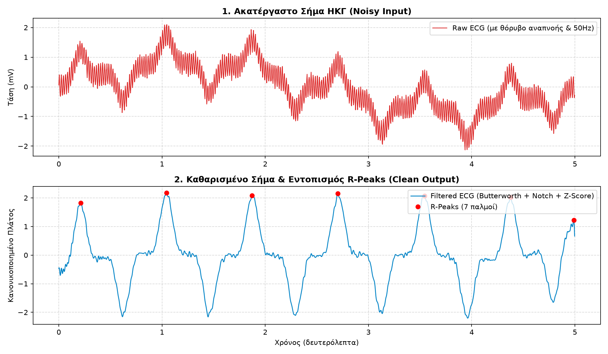
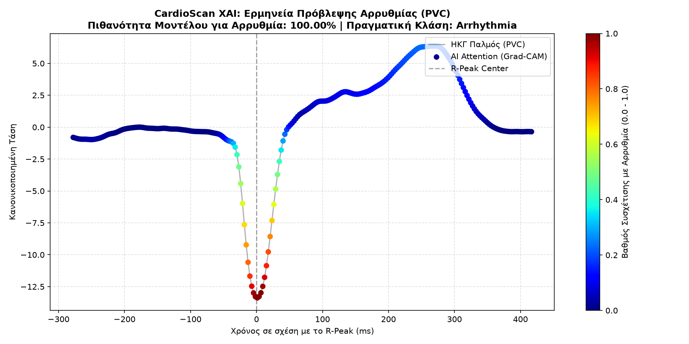

# CardioScan: Explainable AI for ECG Arrhythmia Classification

[](https://www.python.org/)
[](https://pytorch.org/)
[](https://scipy.org/)
[](https://physionet.org/content/mitdb/)
[](LICENSE)

An end-to-end Biomedical Signal Processing (DSP) and Deep Learning pipeline designed to classify cardiac arrhythmias from raw electrocardiogram (ECG) data. The system features automated heartbeat segmentation, zero-phase noise filtering, a custom 1D-CNN classifier, and Explainable AI (1D Grad-CAM) to visualize morphologic regions influencing clinical predictions.

---

## Key Features

- **Biomedical DSP Pipeline:**
  - 3rd-order zero-phase Butterworth bandpass filter (0.5 – 45 Hz) to eliminate baseline wander and high-frequency EMG noise.
  - IIR Notch filter (50 Hz) targeting powerline interference.
  - Dynamic Z-score amplitude normalization.
- **Automated Heartbeat Segmentation:**
  - Window extraction centered on detected R-peaks (-100 to +150 samples, total 250 time steps per beat).
  - Ground truth integration using PhysioNet MIT-BIH Arrhythmia Database annotations.
- **Deep 1D-CNN Architecture:**
  - Multi-scale 1D convolutions with Batch Normalization, ReLU activations, and Adaptive Global Average Pooling.
  - Weighted cross-entropy loss to address clinical class imbalance (Normal vs. Arrhythmia).
- **Explainable AI (1D Grad-CAM):**
  - Generates activation heatmaps mapped back onto temporal cardiac signals, highlighting diagnostic features (such as anomalous QRS width).

---

## Visual Pipeline & Results

### 1. Digital Signal Preprocessing & R-Peak Detection
Raw noisy input with simulated respiratory drift and 50 Hz powerline hum transformed into a clean, baseline-corrected signal with precise R-peak localization.



### 2. Explainable AI: 1D Grad-CAM Activation Map
Model attention localized on a Premature Ventricular Contraction (PVC). High activation areas focus directly on the widened, abnormal QRS morphology rather than background noise.



---

## Model Architecture

| Layer | Type | Configuration | Output Shape |
|---|---|---|---|
| **Input** | Raw ECG Tensor | Single Channel | `(Batch, 1, 250)` |
| **Conv Block 1** | Conv1D + BatchNorm + MaxPool | $K=7, C_{\text{out}}=16$ | `(Batch, 16, 125)` |
| **Conv Block 2** | Conv1D + BatchNorm + MaxPool | $K=5, C_{\text{out}}=32$ | `(Batch, 32, 62)` |
| **Conv Block 3** | Conv1D + BatchNorm + MaxPool | $K=3, C_{\text{out}}=64$ | `(Batch, 64, 31)` |
| **Pooling** | AdaptiveAvgPool1D | Target Length $= 1$ | `(Batch, 64, 1)` |
| **Dense** | Linear + Dropout(0.3) + Linear | Latent $= 32 \to 2$ | `(Batch, 2)` |

---

## Installation & Setup

1. **Clone the repository:**
   ```bash
   git clone [https://github.com/nintaras/CardioScan.git](https://github.com/nintaras/CardioScan.git)
   cd CardioScan


Set up virtual environment:
python3 -m venv venv
source venv/bin/activate
pip install -r requirements.txt

Verify DSP pipeline:
python3 test_pipeline.py

Train the 1D-CNN:
python3 train.py

Run Explainability (Grad-CAM):
python3 explain.py

References
Goldberger, A., et al. PhysioBank, PhysioToolkit, and PhysioNet: Components of a new research resource for complex physiologic signals. Circulation (2000).
Selvaraju, R. R., et al. Grad-CAM: Visual Explanations from Deep Networks via Gradient-Based Localization. ICCV (2017).

License
Distributed under the MIT License.
